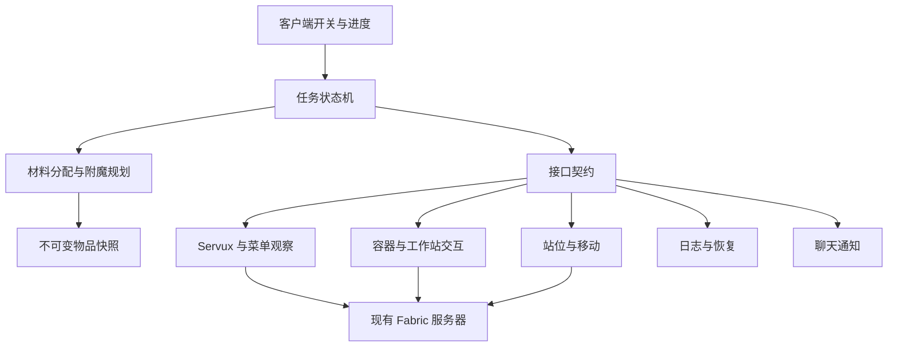
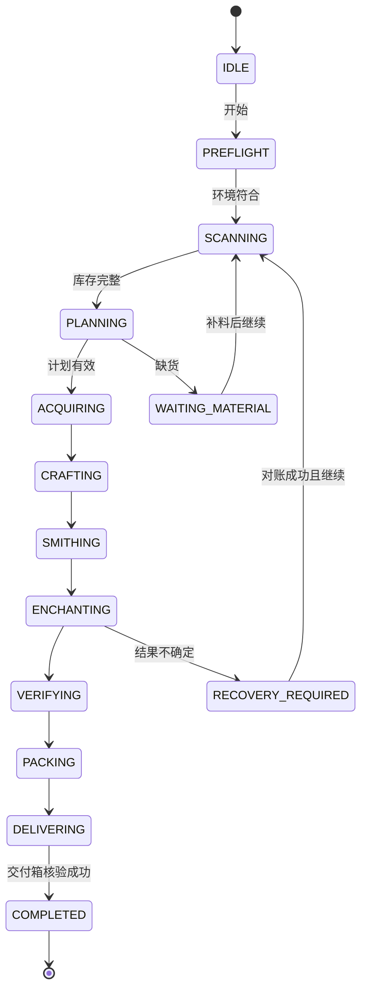

# 新人装备自动制作技术标准

> 2026-10-24 版本调整：旧 v1.0 对应 Alpha 1.0；加入村民交易、尚未加速交易的 RC.5 对应 Alpha 1.2；旧 v1.1 的 RC.6 对应 Alpha 1.3。原 v1.2 仓库物流计划取消，下面的 v1.2 内容仅为历史设计，不属于开发承诺。当前正式版为 1.0，包含设置界面、导航、跳跃提升与自动疾跑。版本和验证范围以 [发布记录](RELEASES.md) 为准。

日期：2026-10-23。适用目标：Minecraft Java Edition 26.2，Fabric 客户端 v1.0–v1.2。

本标准规定架构、边界和验证方法。仓库包含 v1.0/v1.1 候选实现；v1.2 仍为后续目标。当前运行与验证状态见 [v1.1 说明](V11_IMPLEMENTATION.md)，本标准不替代实测证据。

## 1 技术基线

| 项目 | 固定值或约束 | 依据 |
|---|---|---|
| Minecraft | 26.2，协议 776 | 本地游戏 jar 的 version.json |
| JDK | 25，编译 release 25 | version.json 与 Fabric 官方迁移文档 |
| Fabric Loader | 开发固定 0.19.5 | 本地版本 JSON 和 latest.log；目录名称不作为版本依据 |
| Fabric API | 0.158.0+26.2 | 客户端元数据及用户服务端清单 |
| Loom | 1.17.20，固定版本 | 本地现有缓存；1.17 系列为 Fabric 26.2 开发基线 |
| Gradle | 9.6.1，Wrapper 固定 | 使用本机现有官方发行版；构建结果见 VALIDATION |
| 命名空间 | Minecraft 自带的未混淆名称 | 不配置 Yarn 或旧 remap 流程 |
| Servux 服务器 | 0.11.2 | 用户服务端清单；0.11.3.disabled 不生效 |
| Carpet | 26.2+v260616 | 用户服务端清单 |
| 配置格式 | UTF-8 JSON，schemaVersion=1 | 本项目约定 |

服务端 Loader 的精确版本尚未提供。客户端日志只能确认客户端 Loader。服务端必须满足其现有 Fabric API 的版本约束，M0 再记录服务端启动日志。

Gradle 与 Loom 构建配置不得使用动态 `+` 或 `SNAPSHOT` 版本。可复现构建还需要依赖校验和与锁定传递依赖，在 M0 形成首次通过构建的锁定记录。本轮 Wrapper 文件使用校验和；不得把本地模组 jar 的存在当作服务器协议兼容证明。

## 2 部署决策

使用客户端执行器，复用现有 Servux 服务。服务器不用新增本项目模组。服务端 Carpet 假人路线仅保留接口设计，不与客户端路线同时实现。决策详情见 [ADR 0001](adr/0001-client-first.md)。

Servux 提供观察数据，不提供本项目的取物、移动或生产事务。取物、合成、锻造、附魔、交易和装箱必须走服务器认可的游戏交互。不得发送创造模式物品设置包，不得使用 `/give`，不得直接篡改客户端物品后当作完成。

## 3 模块和依赖方向

`engine` 包含模型、库存分配、规划、状态机和接口契约；不依赖任何 Minecraft 类。`client` 将游戏对象转换成快照，并执行 `engine` 产生的动作。版本适配全部留在 `client`。

游戏状态只在客户端游戏线程读取或修改。复杂搜索使用工作线程，只接收快照。每次接纳计划前必须检查快照版本；过期结果作废。规划线程不得调用网络发送、世界查询或槽位修改。

### 3.1 接口契约

以下是文档级契约，不是当前已有 Java 接口。

| 契约 | 输入 | 输出与保证 |
|---|---|---|
| InventoryObserver | 区域、容器引用、请求 ID | InventorySnapshot；失败须区分拒绝、超时、未加载、协议错误 |
| InventoryAllocator | KitSpec、合格库存快照 | MaterialReservation；数量不能重复分配给两件装备 |
| AnvilCostModel | 左右完整物品状态、规则指纹 | 合法性、费用、输出附魔和 repair_cost |
| EnchantmentPlanner | 目标装备、候选书、规则指纹 | PlanResult；显式标记 optimal / infeasible / timeout |
| NavigationPort | 目标坐标、允许区域、交互距离 | 到达可交互站位或有界失败；不挖地、不搭桥 |
| InteractionPort | 前置快照、动作 ID、期望变化 | 实际确认后的 ActionOutcome 或结果未确认 |
| WorkstationPort | 工作站、配方或铁砧步骤 | 包括菜单状态、费用、结果物品的确认记录 |
| TaskJournal | 任务、动作阶段、收支、位置 | 持久化成功才准许推进不可逆步骤 |
| NotificationPort | 缺口集合、事件键、任务 ID | 去重、限频的聊天或本地通知结果 |
| TradePort | v1.1 村民 UUID、报价、预算 | 重新确认报价后的交易结果 |
| TravelPort | v1.2 命令模板、目标区域 | 由位置、维度、稳定时间验证的到达结果 |

### 3.2 数据约定

| 对象 | 必需字段 |
|---|---|
| KitSpec | schemaVersion、id、物品 ID、数量、槽位、完整附魔、耐久约束 |
| ContainerRef | serverKey、dimension、坐标、类型、双箱两半坐标、槽位命名空间 |
| ItemSnapshot | itemId、count、damage/maxDamage、enchantments、storedEnchantments、repairCost、组件规范化哈希 |
| InventorySnapshot | containerRef、revision、observedAt、来源、slot→item、完整性状态 |
| MaterialReservation | taskId、snapshotRevision、容器/槽位、数量、物品哈希、到期条件 |
| AnvilStep | 左右输入哈希、输入数量、expectedCost、输出状态、依赖步骤 |
| TaskRecord | taskId、kitVersion、serverKey、状态、已交付件、半成品位置、未确认动作 |
| ActionRecord | actionId、intent、sentAt、前置/后置快照、阶段、等级变化、错误码 |

不要用显示名称识别附魔书。书读取 `minecraft:stored_enchantments`；装备读取 `minecraft:enchantments`；惩罚读取 `minecraft:repair_cost`。空组件与默认组件必须规范化。自定义名、耐久、未知组件变化不能被仅比较物品 ID 掩盖。

同质物品哈希不是唯一物品序列号。日志通过专用槽位、数量和容器位置追踪中间产物；外部玩家移动了同质物品且无法消除歧义时，进入人工恢复，不编造唯一身份。

## 4 Servux 和库存发现

### 4.1 能力协商

M0 必须在目标服务器验证现有 Servux 0.11.2 的实际握手、协议版本、注册流程、NBT 响应和权限。0.11.4 的公开源码仅作为协议研究参考，不当作 0.11.2 的兼容结论。

预期使用 `entity_data` 数据提供者。配置项候选为 `DataProviderToggles.entity_data` 和 `entity_data.permission_level`。以 0.11.2 的 `/servux list` 实际输出确定修改方式。MiniHUD 的 `entityDataSync` 是客户端设置，不应直接当作 Servux JSON 同名字段。

不要求开启玩家背包或末影箱读取权限。不要为了读箱子而扩大这些权限。数据读取拒绝时可以使用实际打开容器的菜单快照作为回退；界面回退不能假装拥有远程扫描结果。Servux 不可用时默认暂停，只有用户配置 `allowMenuFallback` 才继续回退路径。

### 4.2 与现有客户端模组共存

原客户端安装 MiniHUD 0.40.7、MaLiLib 0.29.6、Tweakeroo 0.29.5；测试不得修改该实例。独立正式实例使用 MiniHUD 0.40.4、MaLiLib 0.29.3，与服务端 Servux 0.11.2 的协议 1 实测握手通过。新 MiniHUD 的协议 2 不兼容该服务端；MaLiLib 0.29.6 也禁止与 MiniHUD 0.40.4 一起启动。

当前客户端通过反射复用 MiniHUD/MaLiLib 的数据管理器，不另注册 Servux payload 或全局接收器。`engine` 不依赖其内部类。远程查询直接请求服务器 NBT，并等待请求 pending 标志由真实回包清除；普通本地缓存刷新不构成权威回包。解码保留完整 27 槽，双箱等待两半后按原版菜单顺序组成 54 槽。兼容配对之外的版本在接入检查中拒绝，不能将本地空占位当作缺货。

RC.6 修订 `rc6-edgefix-20261024` 用可选 `ServuxHandshakeMixin` 观察已有握手入口，检查当前连接的 Servux 版本和协议；不能复用上次连接的握手。观察器同时绑定客户端世界，连接或世界变化后必须重新建立观察。方块回复中的坐标、类型、Items 格式和双箱配对必须一致；实体回复必须含匹配的 UUID。未初始化的 Offers 允许回退打开菜单，畸形 Offers 不得视为空报价。该修订通过编译、依赖接口检查和单人 NBT 接收/缓存校验用例；游戏加载未出现 Mixin 错误。远程元数据经过 Mixin 的完整网络流程仍未验证。

Servux 客户端目录内的 jar 标记为 `environment: server`。它的存在不提供本项目客户端接入 API，也不能证明远端服务器版本。

### 4.3 扫描和缓存

1. 在当前维度、配置边界内枚举已加载区块的容器方块实体。
2. 去重双箱，按可到达距离排序后分批读取。
3. 将完整响应转换为不可变槽位快照。
4. 按物品 ID、附魔集合、等级、repair_cost 和可取性建立索引。
5. 取料前重新读取目标容器；快照变化则重新分配。

不得假设 Servux 可以扫描未加载区块或任意全服坐标。超出可见区块但位于合法平台内的区域，需要导航分段加载并再次扫描。未知库存不等于零库存；扫描不完整时提示“库存未确认”，不得发送确定性缺货结论。

初始参数：10 请求/秒、最多 4 个请求在途、超时 3 秒、只读请求最多重试 2 次。迟到响应必须检查请求代次、服务器、维度、位置，不能覆盖新快照。

快照过期时间默认 10 秒，只用于减少展示读取；实际取料始终重新核对。客户端预留仅是本任务账本，无法锁定其他玩家。原子预留不是 Servux 的保证。

### 4.4 受遮挡潜影盒

按用户确认，不检查潜影盒开盖的碰撞空间。实际取物通过正常容器交互确认。开盖规则不自动增加交互距离，也不等价于穿透任意方块点击；导航必须找到服务器接受的交互位置。实测允许的交互方式记录在场地配置中。

若直接交互失败，报告坐标和失败类别。不得自动关闭 Carpet 规则，不得擅自拆箱。

## 5 合成与锻造

配方以运行服务器同步的配方结果及菜单结果为准，不硬编码屏幕像素坐标。各菜单分别定义槽位适配，区分玩家背包索引与菜单槽位索引。

钻石配方、原料总数见 PRD。优先消耗任务分配的材料，不使用现有私人钻石装备。v1.0 流程固定为合成钻石装备、锻造下界合金、附魔。

锻造必须同时核对模板、基础装备、下界合金锭、结果槽。取出成品后确认三个输入各减少 1，结果符合目标材质。每件升级消耗模板；不使用模板复制逻辑。

每次只准备一件装备及本件必要的中间书；成品尽快存入任务盒。55 本书不得一次塞入玩家背包。规划器必须考虑空槽、光标空间、工作站输入槽和输出槽容量。空间不足先暂停，不丢地腾位。

## 6 最小等级费用规划

### 6.1 优化目标和支持域

主目标是所有铁砧步骤实际扣除的等级之和最小，包括书与书的合并。次目标依次为最高单步费用最小、最终 repair_cost 最小、步骤数最少。使用固定 ID 顺序作最终平局判定，以便计划可复现。

v1.0 精确求解域：一件无额外附魔、满耐久的目标装备；单附魔书具有可读取的非负 repair_cost；标准 26.2 附魔规则。除灵魂疾行、迅捷潜行外，每种附魔恰好一本目标等级书。两种特殊附魔允许 III、II+II、II+I+I、I×4，按此顺序选择首个库存足量的组合。同级选最低惩罚原料。最多 6 种附魔、9 本书，对应靴子使用灵魂疾行 I×4。

候选书有不同 repair_cost 时，比较库存中全部等价类别，保留满足数量的最低惩罚原料。常规支持域中费用随输入惩罚单调不减，因此为每个附魔/等级选择需求数量内最低惩罚的书，不会因位置远而换成更贵的书。共享书的分配仍须全局确定：枚举不同惩罚类别在各件装备间的分配，结合各件精确费用，取整盒最低总值。大量相同状态的书合并计数，不展开为不同对象。

完全同质的零惩罚库存中，逐件最优相加即为整盒最优。非同质库存不可只对各件贪心分配。搜索资源超过预算时返回 `timeout`，不执行标为“最优”的替代启发式计划。

用户要求优先消耗高等级特殊书，因此不跨特殊书等级组合比较总费用。选书策略内，书的升级合并与装备附魔由同一个精确树搜索求解；不固定“先拼出 III 再附装备”的顺序。其他低等级书、多附魔书、诅咒、损坏修复、自定义附魔、额外属性或未知规则输入不进入支持域。不得静默丢掉书的非目标附魔后宣称精确最优。

### 6.2 标准费用模型

对“纯附魔、不重命名、不修复、无不兼容附魔”的支持域，设左右惩罚为 P_L、P_R。右侧一定是附魔书：

`stepCost = P_L + P_R + Σ(max(1, floor(anvil_cost(e) / 2)) × resultLevel(e))`

求和范围是右侧转移的附魔。`resultRepairCost = 2 × max(P_L, P_R) + 1`，实现按游戏整数上限处理。新装备/新书通常为 0，但必须读取实际值。

单步费用必须小于 40，且玩家当前等级不低于费用。费用等于 40 的附魔步骤在标准生存模式不可执行。只改名字的特例不用于本任务。

相同附魔合并时：等级相同则加一，等级不同则取较高值，再按该附魔的最高等级封顶。右侧出现的每种附魔按合并后的等级收费，不能累加右侧原始书的等级费用。灵魂疾行、迅捷潜行最高为 III。附魔适用范围、不兼容附魔费用、物品修复和命名成本通过严格输入限制不进入模型；运行中逐步核对服务器费用和输出。

模型来源为本地 26.2 `AnvilMenu.createResult` / `onTake` 及游戏内附魔数据。服务端 Carpet 附加包改变规则时，基准模型失效；暂停并记录差异。不得仅关闭 40 级检查就继续声称标准最优。

### 6.3 精确搜索方法

把目标装备和书作为叶节点。枚举所有合法的有序二叉合并树，而不是只排列逐本敲书顺序。

- 状态包含使用的原料子集、输出类型、每种附魔的实际等级、输出 repair_cost、累计费用与最高单步费用。同一原料子集可以产生不同等级，必须分别保留。
- 对每个子集枚举所有非空左右拆分，分别考虑书+书的两个方向。
- 装备只能留在左分支，右分支必须是书；禁止把装备放在牺牲书的位置。
- 每个合并调用费用模型，过滤不合法或达到 40 级的步骤。
- 在相同输出语义下保留费用、repair_cost、最高单步费用的非支配状态。不得仅保留“最低累计费用”而丢掉较低惩罚的候选。
- 从完整目标状态回溯得到操作树，再按依赖顺序排列为执行步骤。
- 用缓存复用同物品类型、附魔集合、惩罚、规则指纹的结果。

全盒分配层将每本书只分配一次。精确性说明包括搜索域、规则指纹、最优值及搜索是否完成。性能超时默认 5 秒；只表示需要暂停或扩大规划预算，不代表无可行解。

### 6.4 可人工复核的胸甲例子

前提：胸甲、保护 IV、耐久 III、经验修补 I 的 repair_cost 均为 0。

| 步骤 | 左侧 | 右侧 | 扣除等级 | 输出 repair_cost |
|---|---|---|---:|---:|
| 1 | 胸甲 | 保护 IV | 4 | 1 |
| 2 | 耐久 III 书 | 经验修补 I 书 | 2 | 1 |
| 3 | 步骤 1 胸甲 | 步骤 2 合并书 | 1+1+3+2=7 | 3 |

合计 13 级。另一个顺序逐本附魔也能达到 13 级，但最终惩罚更高。本例是费用模型的手工算例；完整最优性测试必须由独立穷举基准证明，不能把本例当成全套装备的最优结果。

### 6.5 经验预算

没有中途获得经验时，初始等级至少为计划所有步骤费用之和，足以执行整条正费用计划。每步仍要检查实时等级，防止死亡或其他行为消耗经验。

有中途补经验时，逐步费用序列用于检查当前是否可执行。等级之和与经验点数不混用；不根据玩家当前高等级估算“实际经验点最优”。记录服务器前后等级，排除意外拾取经验导致的观测差异；以服务器菜单费用为实际扣除依据。

## 7 交互事务标准

RC.4 在钻石制作前增加 `Procurement`。从最终附魔计划按 ID/等级/惩罚汇总用书数量，并合并弓、盾牌缺口。采购批次先检查预算与背包容量，再集中取得本批全部资金；逐笔购买仍使用完整的真实菜单事务。价格上涨时按剩余批次核算资金。容量不足通过 `ProcurementStorage` 将任务物品写入合格原料容器的空槽，刷新库存后继续采购；初始物品保护与结果确认不变。RC.5 在剩余全部缺口放不下、身上仍有已购产物时，先暂存这些产物，回收全部对应槽位，避免追加 1 件、2 件的小批资金往返。附魔分批计算扣除已在背包中的匹配书，避免重复计算槽位。RC.5 全书采购和少量缺货两个单人场景通过，详见 `V11_RC4_SINGLEPLAYER_VALIDATION.md`；动态价格、暂存填满后 good 和远程协议未覆盖。

报价索引优先使用 Servux `entity_data` 的实体请求。请求前删除旧实体缓存并设置待服务端回复标记；回复后核对实体 UUID，再解码 `Offers`。没有报价数据或响应超时可以回退到真实菜单。每完成一名村民就重置该扫描步骤的进度计时，避免大交易所的持续扫描误触整体超时。Servux 只提供规划候选；实际付款必须使用实际打开的 `MerchantMenu`，每笔交易复核报价及结果。

RC.6 保留原版自动填入的任务货币，只还原受保护槽位中的货币。同一种商品可以在同一菜单连续买到当前缺口上限。付款槽允许超过单笔价格；取结果后必须验证两个付款槽分别准确减少报价数量。普通填料优先整组移动，部分数量使用半组或较少的右键拆分。结束前明确退回任务余款，不能让原版关菜单归还向私人货币合并。每个付款步骤绑定创建时的菜单，页面关闭或更换后不得再搬运。两个槽收费物品相同的特殊报价保留精确填料分支。测试与性能计数见 `V11_TRADE_SPEED.md`。

RC.6 边界修订在尚未提交结果点击时允许报价刷新：明确退回任务付款，重新打开菜单并计算剩余整批资金；资金和剩余商品不能同时放下时取消旧采购批次，重新分批。预算不足时等待 good，不能继续使用旧菜单；预检阶段恢复时重新扫描库存与报价。结果点击已经发出后的付款异常仍属于未确认消耗，不自动重试。暂存全部满时保留已确认存放，重置扫描状态；good 后包含新放置的原料容器，不能复制暂存队列。动态报价、超预算和暂存满恢复的单人结果见 `V11_RC6_EDGE_FIXES.md`。

### 7.1 单个动作生命周期

`INTENT_RECORDED → SENT → OBSERVED → COMMITTED`

发出动作前记录意图和前置快照。收到一致的菜单与背包变化后记录确认。客户端显示的预测结果不算服务器确认。

校验当前菜单类型、containerId、stateId/revision、目标槽位内容、光标状态、输入输出哈希和数量。不得把旧菜单的槽位点击发到新菜单。

同一玩家同时最多执行一个改变库存的动作。不得同时运行 Item Scroller 自动合成、Inventory Profiles Next 自动排序和本机器人槽位写操作。启动检查和操作干扰检测必须覆盖现有客户端组合；无法隔离时暂停并告知需关闭的具体功能，不卸载整个模组。

### 7.2 超时和不确定结果

只读请求可以有界重试。取出铁砧结果、锻造结果、交易结果和挖盒都不可直接盲目重试。超时后先重新读取菜单、玩家背包和目标容器，对比材料与成品变化。

能唯一确认已经成功时提交日志；能唯一确认未执行时重新计划；不能区分时进入 `RECOVERY_REQUIRED` 并停止消耗。日志记录不是服务器原子事务，不能承诺网络下“恰好一次”；必须依赖对账减少重复操作。

### 7.3 铁砧的权威确认

准备左右输入后等待服务器菜单结果。预测费用、实际费用、完整结果组件必须相同，才允许取出。费用不一致时输出差异并暂停，不自动接受更高价格。

取出后核对材料消耗、经验费用、输出和工作站状态。铁砧损坏或消失后重新选择备用铁砧。没有已放置工作站时，重新扫描原料容器，优先取完整、其次开裂、最后损坏的铁砧物品，补到配置工作位。放置使用正常主手交互序列，只发一次；同时等待服务器方块更新与库存减少，不接受本地预测作为提交。槽位换入仅使用非保护任务槽。位置只允许平台内的空方块、有稳定支撑、无液体，不扩大普通导航的建造权限。

工作站和备用铁砧均耗尽进入普通缺货等待；good 后重新扫描，仍无货则再次提醒。铁砧放置超时属于结果不确定，进入 RECOVERY_REQUIRED，不按已知缺货盲目重试。实际操作中发生的不确定结果先对账，不重新打一件来掩盖缺失。

### 7.4 打包和交付

启动固定玩家脚下方块，扫描 X/Z ±5、Y ±1。异步读取区域内淡蓝色潜影盒快照，仅将全部 27 格为空的已放置盒加入固定批次清单。每盒用坐标、初始空状态、淡蓝色类型和任务阶段绑定；不假定潜影盒有原生唯一 UUID。不在原料箱中寻找打包盒。

装箱逐槽校验，最终完整读取 27 格。回收前确认拾取空间和周围环境，挖取只限绑定任务盒。拾取后核对背包里盒子的容器组件；若完整组件暂不可见，在安全点重新放置读取，不直接判为成功。

交付动作完成后重新读取目标交付箱，验证成品盒和收支。成品盒必须正好含目标物品；不得夹带附魔书、余料或其他玩家物品。普通箱作为默认交付容器，不能把潜影盒塞进潜影盒。

## 8 状态机与恢复

图表示主路径，不代表只在附魔阶段可能恢复。任何活动状态均可进入 `PAUSED`、`WAITING_XP`、`RECOVERY_REQUIRED`、`FAILED`、`CANCELLED`。v1.1 增加 `TRADING`，v1.2 增加 `TRAVELLING` 和 `SUPPLYING`。

急停当 tick 停止新增请求并释放模拟按键；已经在网络中的动作继续观察。存在光标物品时不得随意关闭菜单。能安全归位就归位，不能确认则保留界面并提示恢复。

断线/重启后不自动继续点击。验证 serverKey、玩家、维度、任务盒、工作站输入、光标和半成品位置，完成收支对账后再允许继续。死亡后不自动搜尸；报告最后位置和任务资产。

持久化使用追加动作日志与原子替换的状态快照。任务写入独立本地目录，不能持久化认证令牌。版本升级时迁移 schemaVersion；不兼容时保留旧日志并拒绝直接恢复。

## 9 错误码与通知

| 错误码 | 行为 |
|---|---|
| MATERIAL_MISSING | 汇总具体数量缺口，等待补充 |
| SOURCE_UNSUPPORTED | 说明存在不符合规格的书，不使用这些书 |
| XP_INSUFFICIENT | 显示当前等级、下一步费用、剩余总费用 |
| INVENTORY_UNKNOWN | 扫描不完整，不误报确定缺货 |
| SERVUX_UNAVAILABLE / PERMISSION_DENIED | 报告能力或权限问题，按配置回退或暂停 |
| CONTAINER_UNREACHABLE | 显示坐标和交互失败原因 |
| INVENTORY_CHANGED | 重新读取、重新分配；歧义未消除时恢复处理 |
| NO_WORKSTATION / OUTPUT_FULL | 等待工作站或交付空间 |
| PLAN_INFEASIBLE / PLAN_TIMEOUT | 区分无合法解与尚未求完 |
| COST_MODEL_MISMATCH | 停止取结果，保留输入并展示差异 |
| ACTION_UNCERTAIN | 不重发消耗动作，转入对账 |
| TRADE_UNAVAILABLE / TRADE_BUDGET_EXCEEDED | v1.1 等待、换村民或通知 |
| TELEPORT_FAILED | v1.2 保留任务盒并停止物流 |

缺货去重键为 taskId + 规范化缺口；费用/权限/交互错误不得合并成“缺材料”。消息不包含服务器密码、地址凭据或完整原始 NBT。

## 10 测试与发布标准

- 费用模型：对标准规则的边界和已知算例验证；独立穷举对照精确规划器。
- 库存分配：同质与不同 repair_cost 书的整盒最优；不得跨装备重复占用同一本。
- 协议：用真实目标版本确认握手、拒绝、迟到响应和已有客户端共存。
- 交互：真实服务器菜单作为权威结果；在可控延迟、外部取物、断线时验证对账。
- 生产：真实客户端通过工作台、锻造台、铁砧完成整盒；测试代码不能直接赋予最终装备代替流程。
- 完整清单见 [验收用例](ACCEPTANCE.md)。

发布必须附：版本矩阵、模组清单、相关 Carpet 规则、构建哈希、三盒验收记录、已知限制。不得把空框架的 `NO-SOURCE` 测试任务描述为算法测试通过。

## 11 初始规划时的框架约束（历史记录）

本轮创建 `engine` 与 `client` 两个构建模块。源码目录为空。`fabric.mod.json` 只声明客户端环境和依赖，不声明不存在的入口类或 Mixin。JSON 清单是设计数据，当前没有加载器。

不自动部署到 PCL，不修改服务器规则，不创建服务器假人，不发布仓库或制品。后续的第一个实现阶段是 M0 的协议与菜单探针，而不是直接编写全自动循环。

## 追加实现约束：批量和原料来源

原料候选方块严格过滤为 `Blocks.SHULKER_BOX` 和 `Blocks.CHEST`。双箱按逻辑库存去重。彩色盒及木桶不进入来源索引，取物前再次验证来源类型。产物校验要求淡蓝色潜影盒物品，且内部恰好 14 件目标装备。

## 追加实现约束：v1.1

本节覆盖早期规划中的交易超时、原料来源和执行顺序设想。自 v1.1 起，只运行独立单人存档测试；不得为验证连接正式服务器。

### 报价与购买

`Trading` 在平台边界内索引成年职业村民 UUID。逐个交互，读取 `MerchantMenu.getOffers()` 的产物组件、两项当前价格、使用次数和上限。缓存只是规划候选，不能当作已领取的库存。购买前重新打开真实菜单。允许的付款物品仅为普通书、绿宝石；默认商品为单附魔书及无附魔、满耐久、无改名、无铁砧惩罚的弓和盾牌。允许自定义实际报价中的灵魂疾行、迅捷潜行。

精确规划的书池同时包含实际库存和不足部分的报价候选。同种书只补实际缺口；实际库存足够的书不因发现更低惩罚报价而额外购买。特殊书实际库存足够合成 III 时，继续使用这些库存。报价候选不预先大量购买，批次配书时才交易，防止占满背包。交易前再次核对商品、价格和限购状态；报价变动不能静默改变已有附魔树。

`ServerboundSelectTradePacket` 会让服务端自动从整个玩家背包填料。因此，客户端只预测选择索引，不预测物资移动。保存全部 36 格快照，发送选择包一次，等待服务端菜单更新。把自动填入的付款逐项还原至原槽，再核对整个快照。随后仅放入本任务领取的精确付款。结果点击只发一次；确认光标是预期产物、两项付款均清空，再存入空背包槽。菜单改变或超时进入对账，不重发购买。非零索引也必须同步客户端 `setSelectionHint`，防止客户端自行计算其他报价的预览产物。

绿宝石不足时刷新合格原料源，按缺口领取所需绿宝石块，在一次工作台菜单内逐块确认 1→9 的真实结果，并合并已有任务堆叠，避免高价报价挤满背包。普通书或绿宝石仍不足则进入 `WAITING_MATERIAL_OR_XP`，等待真实玩家 `good`。初始玩家货币不计入可用数量。

`TradeCooldown` 使用单调的检查状态和真实时间间隔 20,000ms。首次售罄只安排复查；第二次仍售罄通知一次；后续检查只写日志。发现任一次售罄等待后恢复交易时通知一次。冷却不触发 2,400 tick 的普通步骤超时；导航、选择、移动和结果点击保留各自超时。挂起期间不执行检查，继续后至多立即检查一次，不追补所有过期轮次。原料补货的 `good` 门禁与村民自动补货分别建模。

### 集中制作与背包预算

`ProductionBatches` 先一次取齐 40/12/11/11 原料。工作台菜单连续制作 11 件钻石装备，随后同一锻造菜单连续升级 11 件。全部基础装备先进入绑定产物盒。

从装备清单当前偏移选择最长可行前缀。每件占 1 槽，每本书占 1 槽；相同书仍是不同实物。计算时扣除保护槽、杂物、现有货币和余料。原料充足批次预留 2 槽供结果和备用铁砧；需要交易的批次预留 4 槽供付款、结果和备用铁砧。按整个前缀汇总同种书数量，完成取书/交易后集中附魔，同一铁砧菜单可连续执行；铁砧损坏后沿用 v1.0 的补位和结果对账。整批成品一起放回各自固定槽，再计算下一批。最终仍只认可完整 14 件盒及服务端确认的交付。

`Move` 支持同组件堆叠合并，完整堆叠用一次放下点击，部分数量逐个右键确认。`Put` 可以合并多个任务堆叠，不能从保护槽领取付款或原料。所有变更仍发送原始点击包并读取服务端状态，不依赖客户端库存预测。

### 进食与控制

`FoodControl` 在启动、关闭菜单后的步骤边界检查饥饿，不干扰非空工作站输入或光标。阈值为 ≤14，每次只吃 1 份。安全食物要求 FOOD、CONSUMABLE、正营养、无食用效果且无返回容器。背包食物可暂移至任务快捷栏；快捷栏满时暂存一个任务物品，结束后还原。副手食物原位使用。此消费是初始物品保护的明确例外。

进食后同时要求食物数量减 1、饥饿值上升、对应背包槽和饥饿值的新服务端更新。`FoodUseMixin` 只阻止持续使用键自动开启第二次物品使用，不阻止控制器启动首次食用。暂停立即释放使用动作；继续时先识别是否已消费，不能重复吃掉一份。无食物只通知并继续，按一次缺货期间去重。

聊天匹配 `good|pause|continue` 的独立消息，忽略大小写与首尾空白。签名聊天用原始正文；无签名回退只接受在线玩家的 `<name> command` 格式。`pause` 保留队列及光标，`continue` 调用既有恢复门禁；不得绕过缺货等待或不确定状态。`good` 只解除缺货门禁，不解除手动暂停。非标准聊天插件格式需要单独适配。

启动盒清单与原料平台边界分别建模。每盒完成权威交付确认后递增 `deliveredKits`，余盒重新扫描/规划；队列全部结束才标记整批 `COMPLETED`。日志包含 `batchSize`、`deliveredKits` 和当前任务盒坐标。缺货后只接受玩家 `good`，不通过自动重扫或普通 resume 绕过。手动急停与缺货等待分别记录，good 不解除手动急停。
